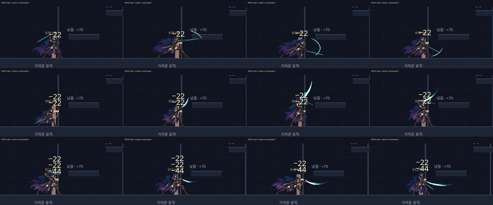
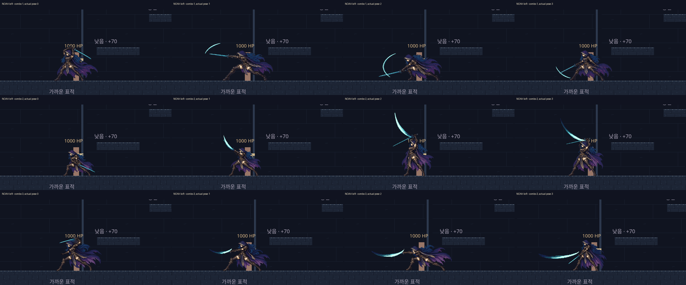
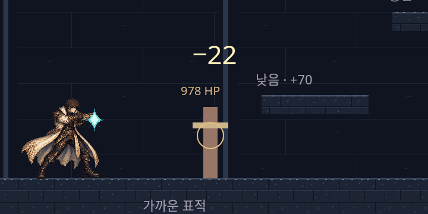
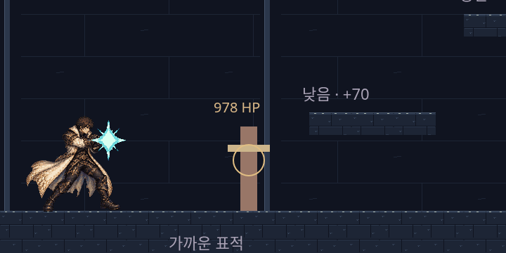
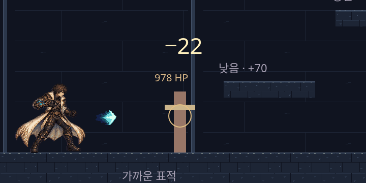
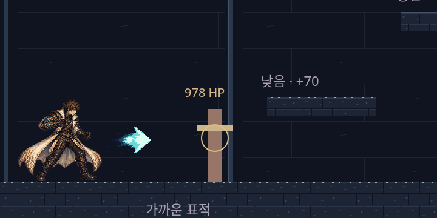
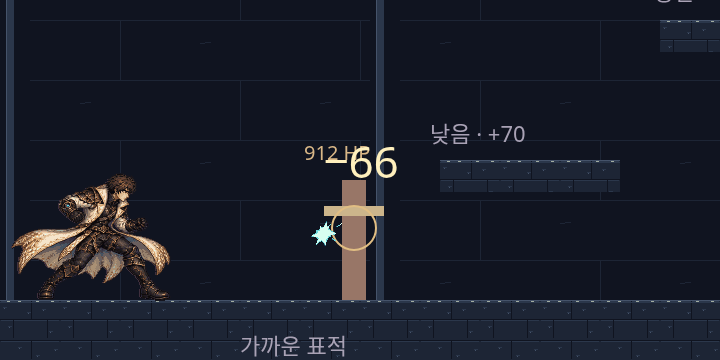
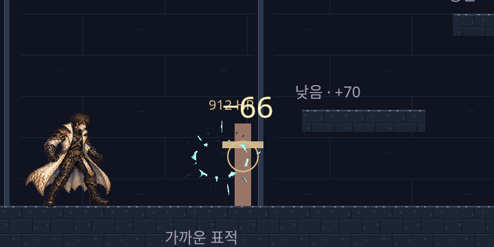
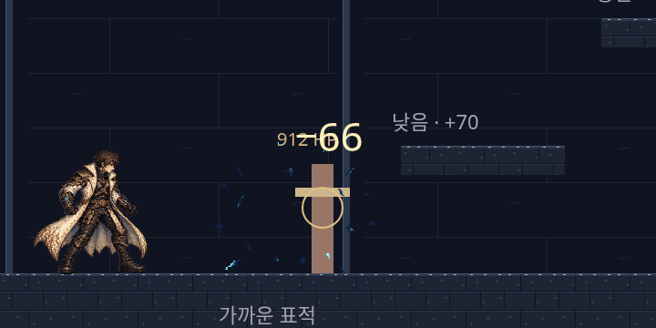
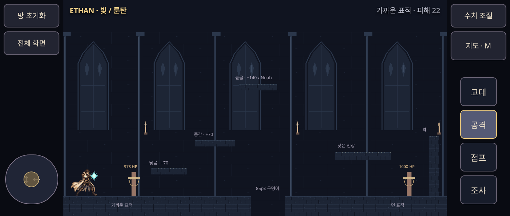

# TASK_09 · 실제 입력 전투 캡처 (2026-11-02)

기준origin/main4ec1cfa → codex/hollow-keep-combat-weapons / PR #20 / 담당Codex, 재검토Claude Code대기. 체력/적/보스는이번범위밖입니다. 손맛·외형·움직임은사용자판단입니다.

32장의실제입력캡처를10장무손실WebP로정리했습니다(총710890바이트). Noah각방향1·2·3단×각4자세를원래720×360픽셀그대로2개보드에배치했고, 원본영역RGBA동일을검사했습니다. 나머지충전/탄/빛터짐/모바일8장도PNG원본과RGBA동일합니다. 보드는시간간격을압축한자세비교이며 실제공격대기시간을보여주는동영상이아닙니다.

재현: 루트HTTP8765 후 `node games/the-hollow-keep/next/tools/capture-combat.cjs`(CHROMIUM_PATH지원, HK_URL기본?room=test, HK_SHOT_DIR기본/tmp/hk09-review). 실제키보드/모바일CDP터치를사용하고 시계는스케줄링만바꾸며 월드·위치·그림주입은하지않습니다. `python games/the-hollow-keep/next/tools/pack-combat-review.py`는리사이즈없이보드/무손실파일을만듭니다.

## Noah 오른쪽·왼쪽 연속 콤보

행=1/2/3단, 열=준비/휘두름/끝/복귀. 1단베기→2단올려베기→3단가로베기/디딤. 실제키누름은첫공격/4틱후/22틱후로다음단을미리입력합니다. 각방향12몸자세와9효과프레임이실제렌더에서그려지는것을검사합니다.

## Ethan 충전과 탄

누른순간기존1단탄이먼저나가고, 누르고40틱/80틱에2/3단이되어놓으면충전탄을쏩니다. 충전빛은네이티브3개크기뱅크로단계를구분합니다. 1단탄/기존그림은보존했습니다.

## 3단 빛 터짐

맞은면가운데에서3프레임한번재생. 직접맞은표적은66탄피해만, 다른표적은반지름45안에서33(퍼즐벽에는영향없음). 시험방캡처는실제표적에부딪친효과이며 주변피해/벽비파괴는weapons-edge로별도확인합니다.

## 모바일780×330

실제터치로공격버튼을누른채3단까지유지하고, 손을떼면충전탄발사·pressed해제를검사했습니다.

전체검증/로그: [TEST_RESULTS](TEST_RESULTS.md). 실제휴대전화회전·터치감·성능은미확인입니다. 병합·수동배포없음.
