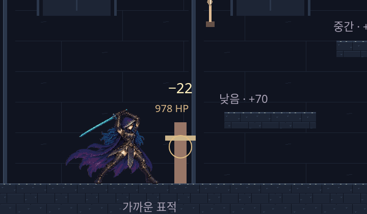
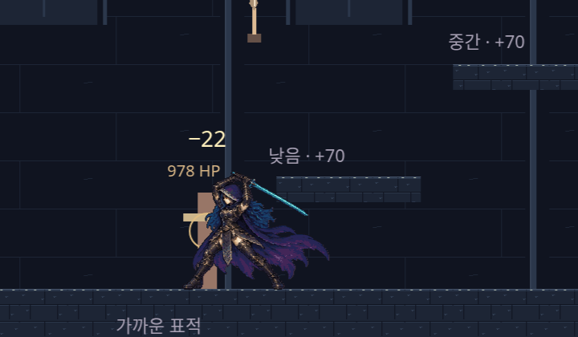
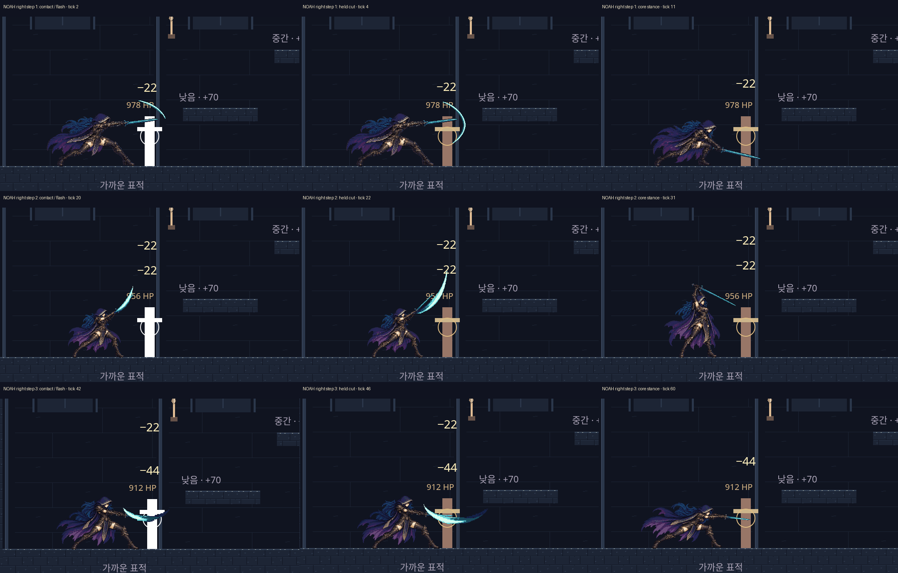
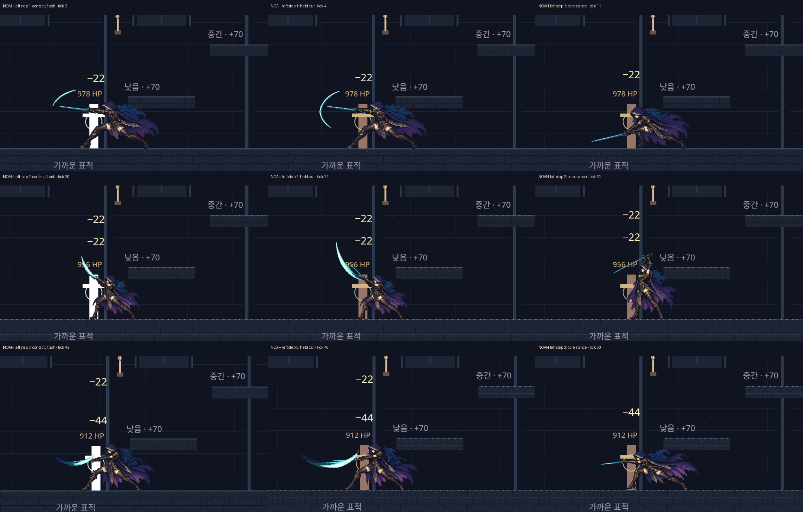
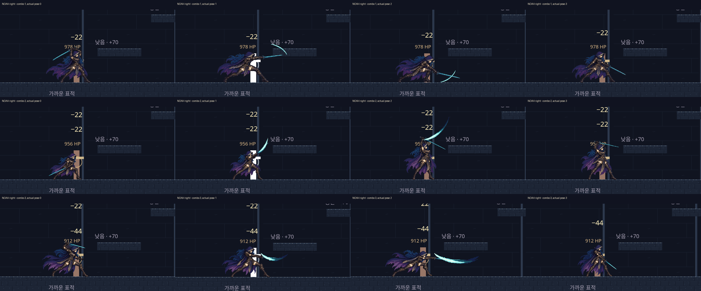
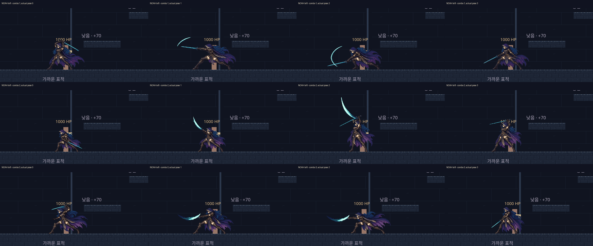

# TASK_09 추가 수정 · Noah 베기 박자·명중 연출 (2026-11-02)

PR #20 / Codex 구현 / Claude Code 재검토 대기. 기준 `bf87c75`, 정정 규격 `097119f`를 `e1a4409`로 병합했습니다. 기존 제출 캡처는 상위 폴더에 보존합니다. Ethan 충전은 유지하고 Noah의 박자·몸 동작·명중 표시를 보완했습니다. 효과음은 없습니다.

| 단 | 다음 공격까지 | 동작 프레임별 시간 | 기본 동작 길이 | 명중 시 추가 자세 유지 |
| --- | --- | --- | --- | --- |
| 1 | 18틱 | 2 / 2 / 9 / 3 | 16틱 | 3틱 |
| 2 | 22틱 | 2 / 2 / 12 / 4 | 20틱 | 3틱 |
| 3 | 34틱 | 2 / 2 / 22 / 6 | 32틱 | 5틱 |

준비 → 짧은 베기 → 길게 보이는 핵심 자세 → 거두기 순서입니다. 준비 중 명중하면 표시 효과만 첫 베기 프레임에 맞춥니다(최대2틱 뒤). 피해와 게임 시간은 원래 틱에서 처리됩니다. 표적은2틱 하얗게, 그림만3→2→1→0픽셀 뒤로 밀렸다 돌아옵니다. 3단 명중에만6틱·최대3픽셀의 감쇠 흔들림이 있습니다. 피해 숫자는 작게 떠오르며 서로와 HP 표시를 피합니다.

## 실제 속도의 좌우 연속 영상

각각82개의 실제 입력 틱을1.367초로 묶은 무손실 영상입니다. 틱마다 기록한 화면을 그대로 사용했고 디코딩된 프레임/시간이 원본과 같음을 검증했습니다. 반복 재생 끝에서는 처음 위치로 돌아갑니다. 실제 게임에는 그 위치 초기화가 없습니다. 세계·좌표·그림을 주입하지 않았고, 키보드와 스케줄링 시계만 사용했습니다.

## 명중과 멈춘 자세

행은1·2·3단, 열은명중(밝힘·밀림·3단 흔들림) / 붙잡은 베기 / 핵심 자세입니다. 핵심 자세는 효과가 걷힌 뒤의 중간 프레임을 골라 몸 동작이 보이게 했습니다. 캡션의 틱은 실제 공격 시작 기준 영상 틱입니다.

## 단계별 전 자세와 Ethan·모바일 회귀

몸 자세 전12개·베기 효과 전9개 프레임을 실제 좌우 입력에서 확인했습니다. 아래 두 보드는 자세 비교이며 시간 간격을 나타내지 않습니다. Ethan2·3단 자세·빛·탄·빛 터짐과 모바일 누르고 놓기도 다시 검사했습니다.

[충전2단](ethan-charge-2.webp) · [충전3단](ethan-charge-3.webp) · [2단 탄](ethan-projectile-2.webp) · [3단 탄](ethan-projectile-3.webp) · 빛 터짐 [0](ethan-burst-0.webp)/[1](ethan-burst-1.webp)/[2](ethan-burst-2.webp)

## 재현과 한계

루트 HTTP8765 후 `HK_SHOT_DIR=/tmp/hk09b-review node games/the-hollow-keep/next/tools/capture-combat.cjs`, `node games/the-hollow-keep/next/tools/capture-combat-feel.cjs`를 실행합니다(CHROMIUM_PATH 지원, 기본 ?room=test). 정리는 `pack-combat-review.py /tmp/hk09b-review games/the-hollow-keep/next/assets/combat-review/followup`, `pack-combat-feel.py`입니다. 별도 자세32장과 연속164프레임을14개 WebP(정지12·연속2, 총1799778바이트)에 담았습니다. 보드 원본 영역과 저장/해독 RGBA, 영상 시간축을 검증했습니다. 원본 캔버스 관찰값은 noah-right/left-observations.json에 있습니다.

[검증 결과·로그](TEST_RESULTS.md). 자동 검사 통과는 손맛 승인이 아닙니다. 사용자 판단과 Claude Code 교차 검토, 실제 기기 확인이 남아 있습니다. main 병합·수동 배포하지 않았습니다.
