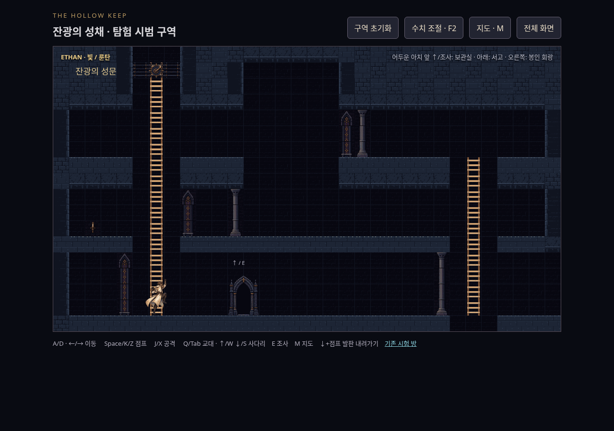
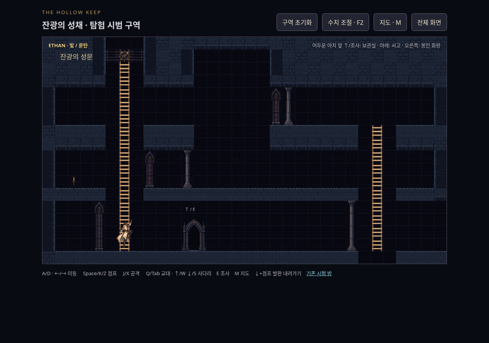
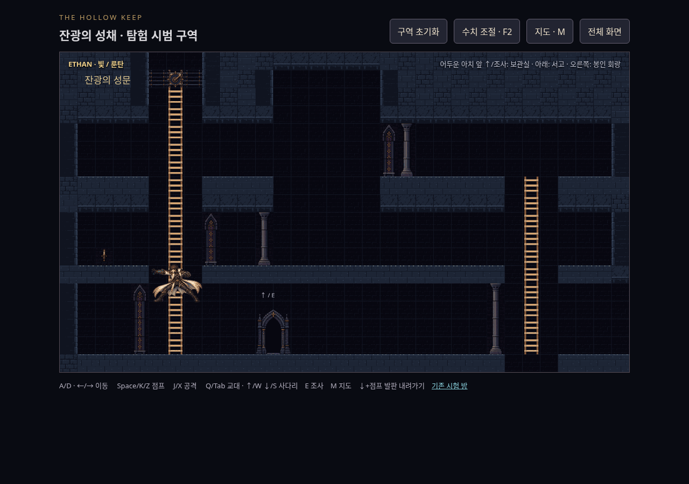
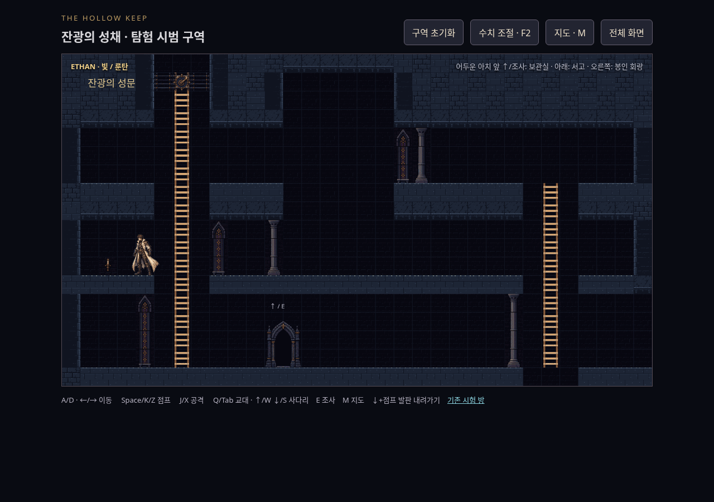
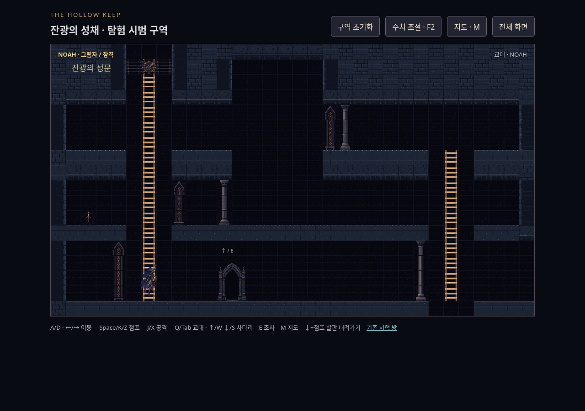
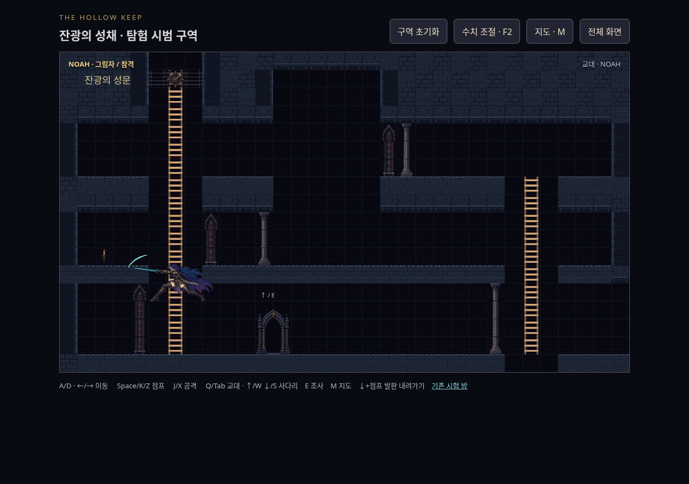
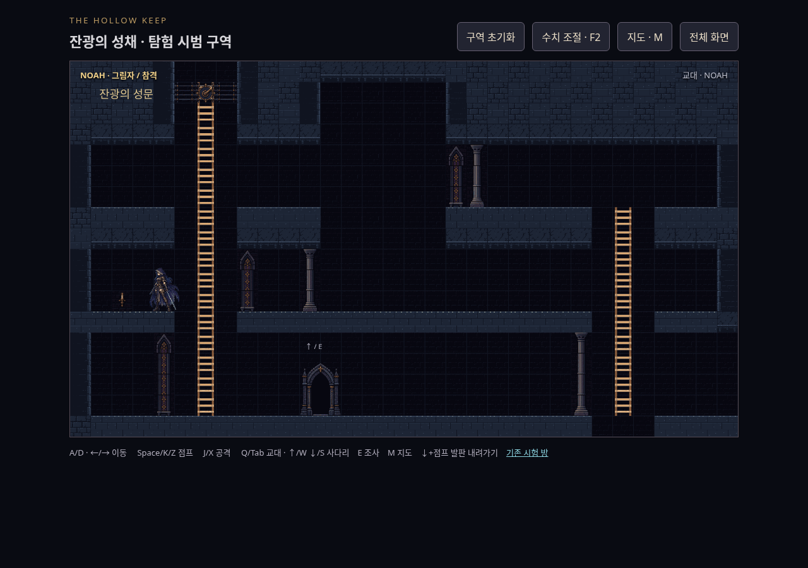
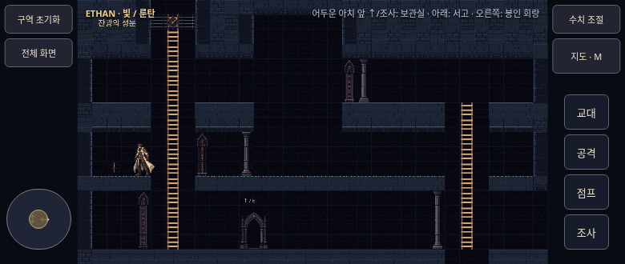

# TASK_08 사다리 검토 캡처

2026-11-02 / Codex / origin/main 1dea1e2 → PR #17. 실제 키보드 입력·시뮬레이션·렌더러로 캡처했습니다. 시계 제어는 스케줄링만 바꾸며 월드·위치·그림을 주입하지 않습니다. 두 주인공 각각 실제 climb 0~3프레임, 매달린 왼쪽 공격, 성문 중간층(y=360)으로 내림, 780×330 화면 총13장입니다. PNG 원본과 디코딩 RGBA가 동일한 무손실WebP로 저장했습니다(총3414518바이트).

재현: 저장소 루트 HTTP8765 후 `CHROMIUM_PATH=/usr/bin/chromium node games/the-hollow-keep/next/tools/capture-ladder-actions.cjs` (출력 /tmp/hk08-review). `HK_URL`·`HK_SHOT_DIR` 지원. `build-climb.py` 재생성으로 두PNG/manifest 해시가 같습니다.

## ethan

## noah

외형·움직임·손맛은 사용자 판단입니다. 반대쪽 교대 자세의 후면 반전으로 의상 비대칭도 반전됩니다(PROVENANCE 참조). 실제 기기 회전·터치감은 미확인입니다. Claude Code 재검토 대기, 병합·수동 배포 없음.
