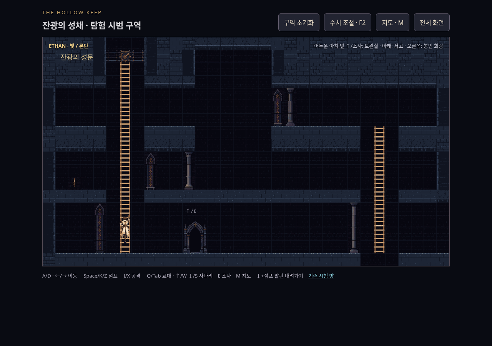
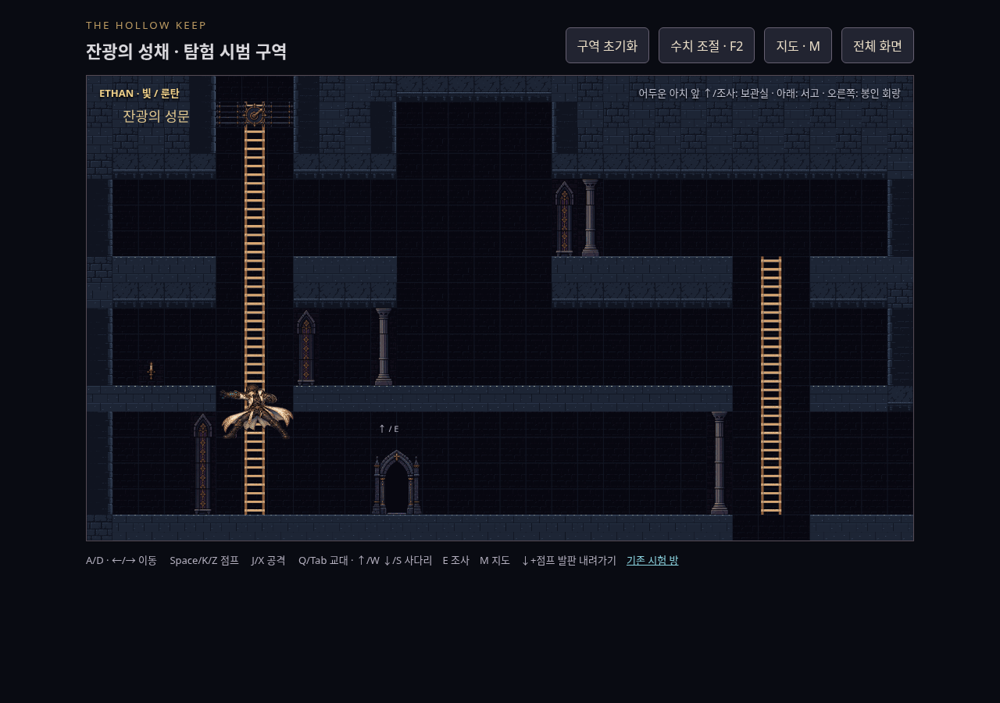
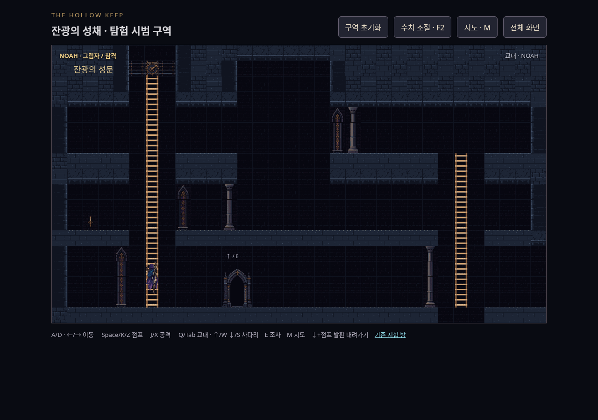
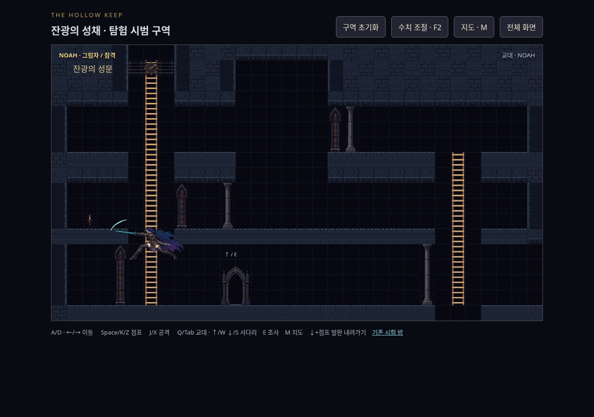
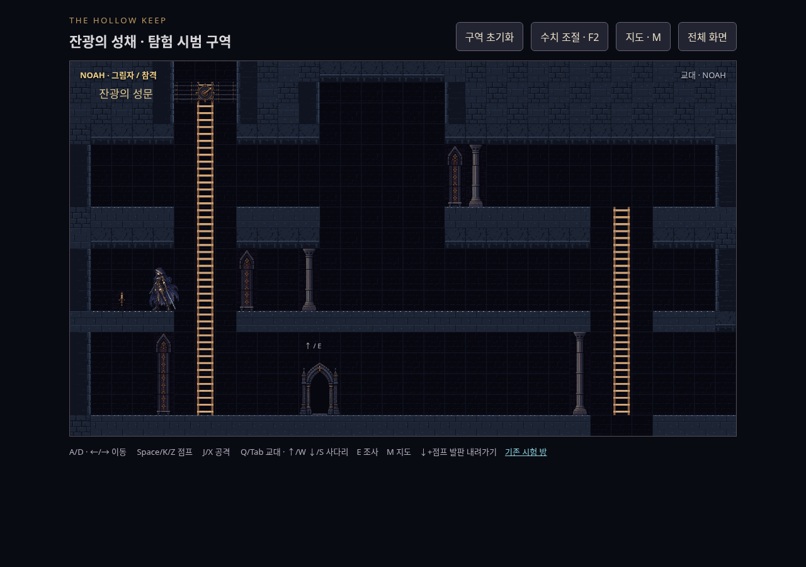
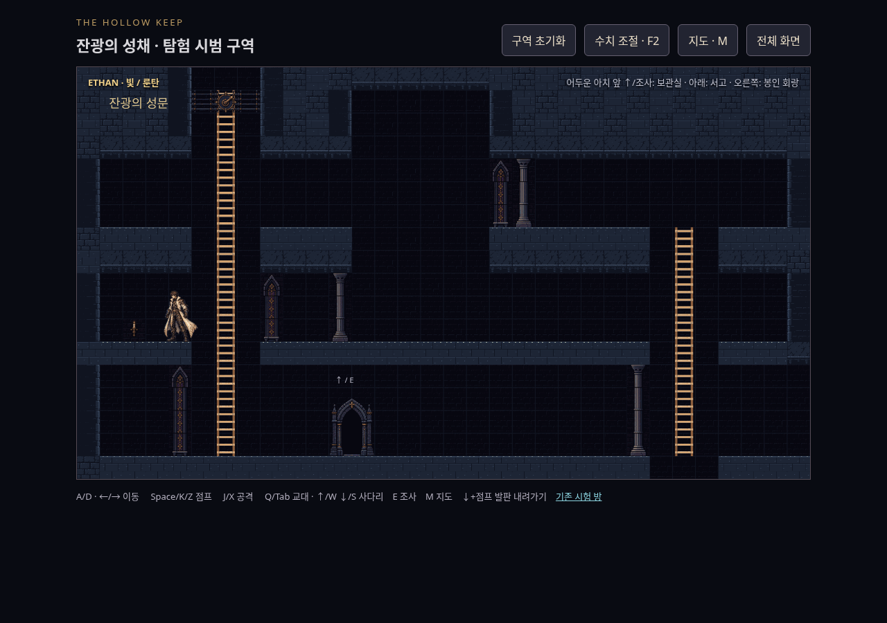
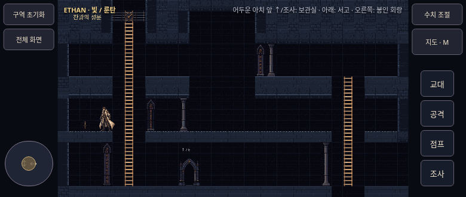

# TASK_08 추가 지시 1·2 · 검토 캡처 (2026-11-02)

PR #17 / Codex. `dc5e336`에서 정정 규격 브랜치를69e8497로 병합한 뒤 대각선·균일 가로대·중앙 오르기 자세를 함께 보완했습니다. 기존 캡처는 상위 폴더에 최초 제출 이력으로 보존합니다.

현재 옆으로 내림은 ↑/↓ 없이 좌우만 누를 때이며, 대각선은 오르내림을 유지합니다. 가로대 시작7/27/47px·두께6px, 이음새까지20/20/20px 간격입니다. 새 원본의 네 자세를 각각 사용(전체 의상반전 없음), 무게중심 오차최대0.247단위·올린손오차최대6.591단위. 기존136/128px·scale2·64색·binary alpha 유지.

캡처는 실제 키보드입력·시계스케줄링·게임렌더로 만들었습니다(좌표/월드/자산 주입 없음). 두 주인공각4프레임+매달린공격+옆바닥내림, PC연속사다리, 모바일780×330 총14장. 무손실WebP 총3665878바이트, PNG원본과 디코딩RGBA동일.

재현: 저장소루트 HTTP8765 후 `HK_SHOT_DIR=/tmp/hk08b-review CHROMIUM_PATH=/usr/bin/chromium node games/the-hollow-keep/next/tools/capture-ladder-actions.cjs`. 대각선으로오르다 발높이366이하에서↑를놓아360층에내리는입력입니다. `build-tile-mosaic.py`→`build-climb.py` 재실행으로 tiles/climb2PNG/manifest해시동일, 다른타일픽셀RGBA동일.

## ethan

## noah

## 연속 사다리·모바일

외형·움직임·손맛은 사용자 판단, 실기기 회전/터치/성능은 미확인입니다. Claude Code 재검토 대기. 병합·수동배포 없음.
