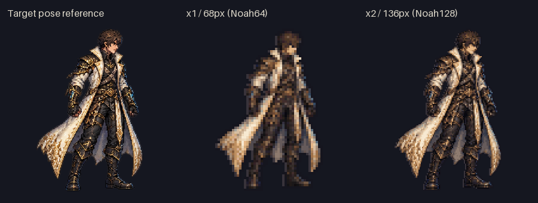
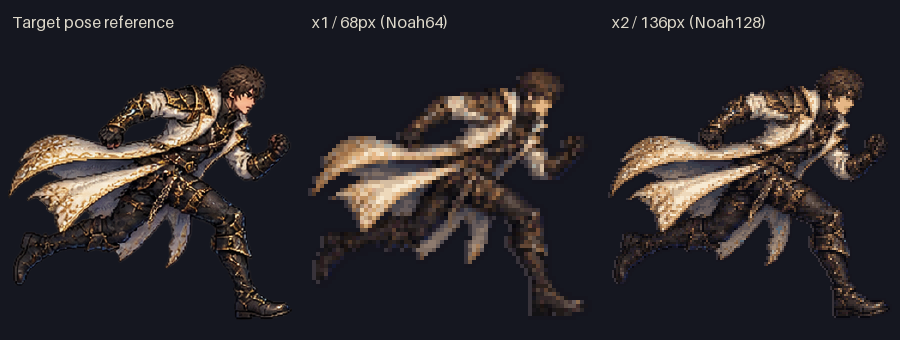
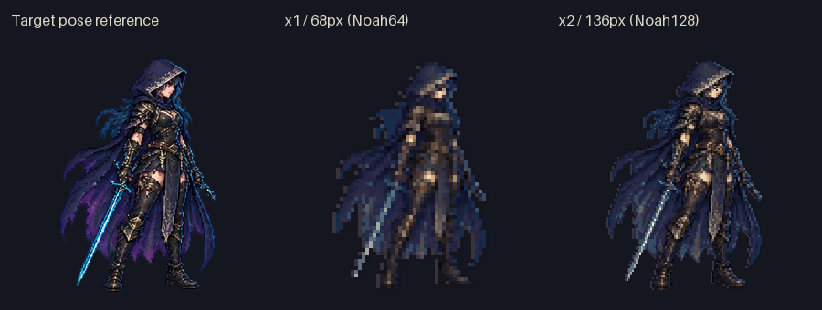
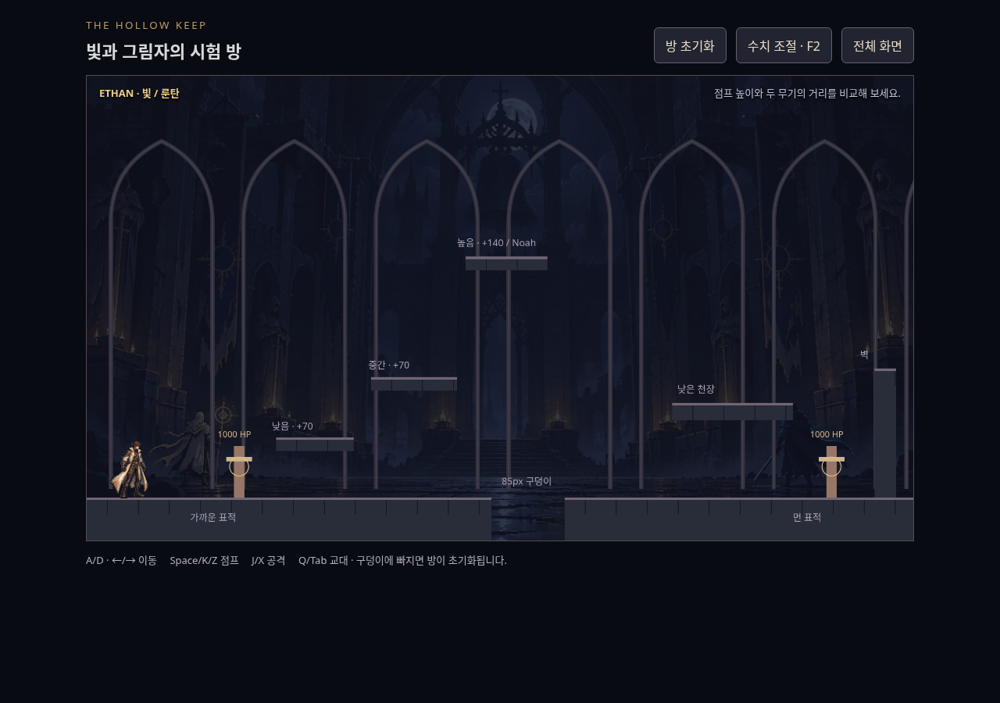
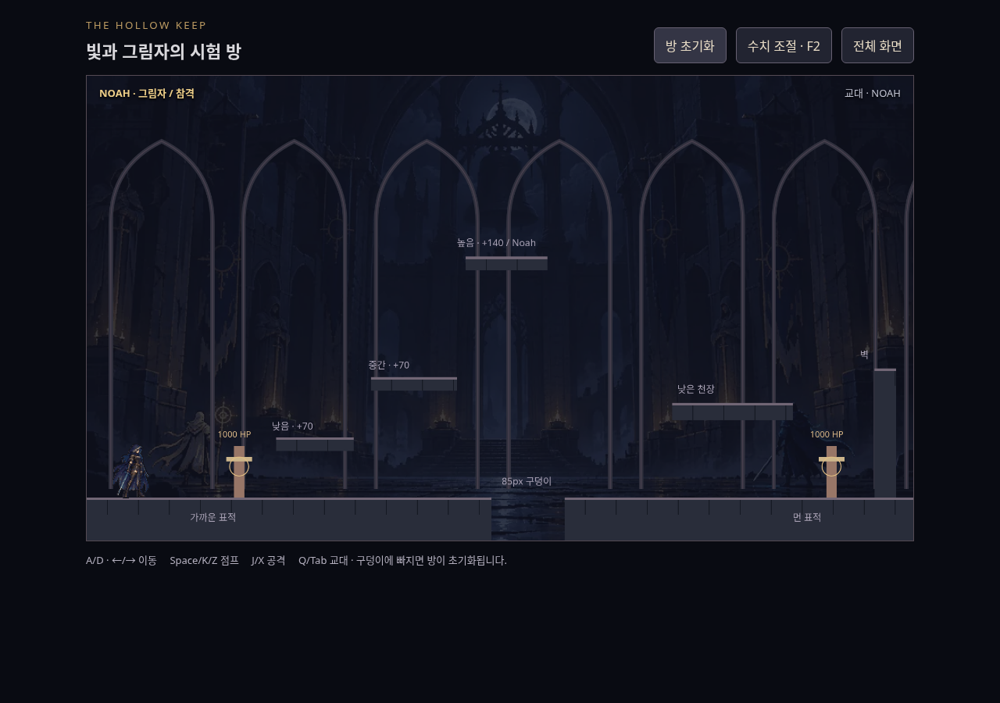
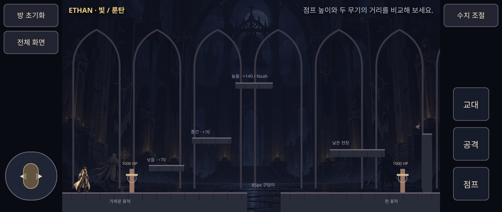
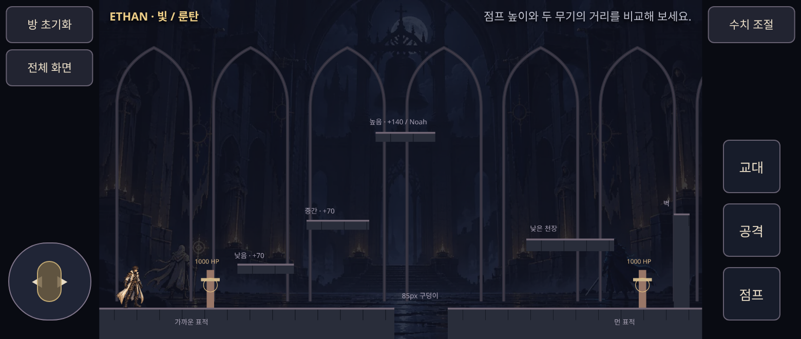
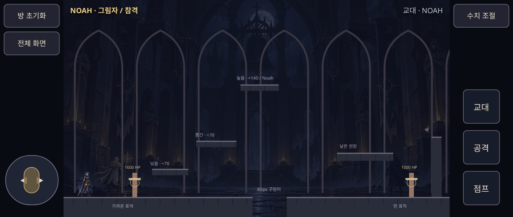

# 목표 외형 · x1 / x2 비교

밀도는 사용자가 선택합니다. 어느 쪽이 더 낫다는 판정은 하지 않았습니다.

- x1: Ethan 68px / Noah64px 기준, scale1.
- x2: Ethan136px / Noah128px 기준, scale2.
- 게임 속 몸 크기·속도·방·조작은 같습니다. 두 시안은 같은 원본을 각각 독립 샘플링하고 같은 64색 팔레트로 손질했습니다. x2를 x1의 단순 2배 확대로 만들지 않았습니다.
- 아래 첫 세 이미지는 목표 참고 자세 / x1 / x2를 같은 표시 높이로 나란히 놓았습니다. 런닝 그림은 구부린 자세 때문에 서 있는 그림보다 실제 높이가 낮습니다. 화면 캡처는 실제 게임 재생 중이며 idle 호흡 프레임은 조금 다를 수 있습니다.

## 같은 높이의 자세 비교

## PC 1280×900

| x1 | x2 |
| --- | --- |
|  |  |
|  |  |

## 모바일 780×330 / DPR2

| x1 | x2 |
| --- | --- |
|  |  |
|  |  |

실행 주소는 `/games/the-hollow-keep/next/?art=trial-x1` 또는 `?art=trial-x2`입니다. Ethan idle/run과 Noah idle만 새 시험본이며 다른 동작은 도형으로 표시합니다. 전체 재제작·베기 효과는 밀도 선택 이후입니다. 실제 휴대전화의 새 그림 확인은 별도로 필요합니다.
